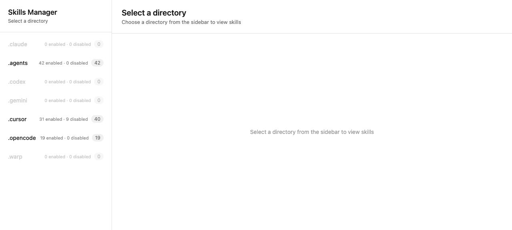

# Skills Manager

Local web GUI for managing Claude Code/Agent skills.

## Run

```bash
pnpm install
pnpm start
```

Server runs at `http://localhost:3000`



## Test

```bash
pnpm test
```

## API

| Endpoint | Description |
|----------|-------------|
| `GET /api/roots` | List all skill roots with enabled/disabled counts (.cursor, .agents, .opencode, etc.) |
| `GET /api/groups/:root` | List groups for a root (404 unless the root has groups; only .cursor does) |
| `GET /api/skills?root=&group=` | List skills in a root/group |
| `GET /api/skill/:root/:skill?group=` | Get skill content + `reference*.md` files |
| `POST /api/skill/toggle/:root/:skill?group=` | Enable/disable a skill |
| `GET /api/health` | Health check (`status`, `uptime`, `timestamp`) |

`:skill` can be a nested path (e.g. `skills/foo`); nested folders are resolved recursively.

## Structure

```
server.js               # Entry point (starts the HTTP server)
server/
├── config.js           # Constants (roots, groups, port, skip list, path guard)
├── index.js            # HTTP server + routing + static file serving
├── controllers/        # Request handlers
├── services/           # Business logic
│   └── helpers/        # Directory walking, skill collection/counting
└── utils/              # Logger, URL parser
public/                 # Front-end (index.html, app.js, styles.css)
```

## How it works

- Scans `.claude`, `.agents`, `.codex`, `.gemini`, `.cursor`, `.opencode`, `.warp` directories under the home directory
- For `.cursor`, groups skills into: skills, skills-cursor
- Skills are detected by `SKILL.md` files; hidden entries and cache/temp/vendor directories (plugins, cache, tmp, vendor_imports, node_modules, logs, sessions, etc.) are excluded from scans
- Disabling a skill moves its folder to `temp_disabled_skills/` at the root level

## Tech

- Node.js native http (no dependencies)
- Tests use Node.js built-in test runner
